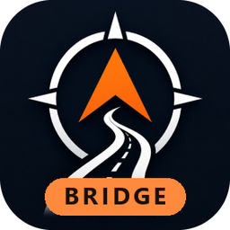
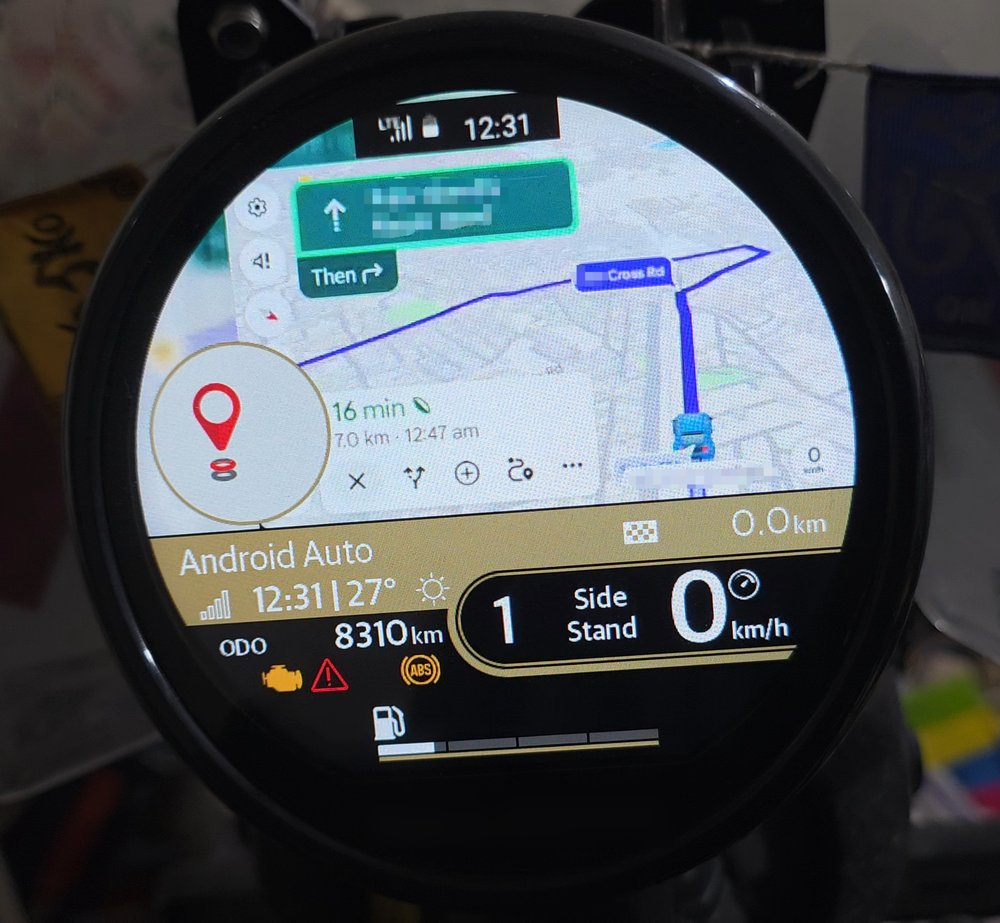
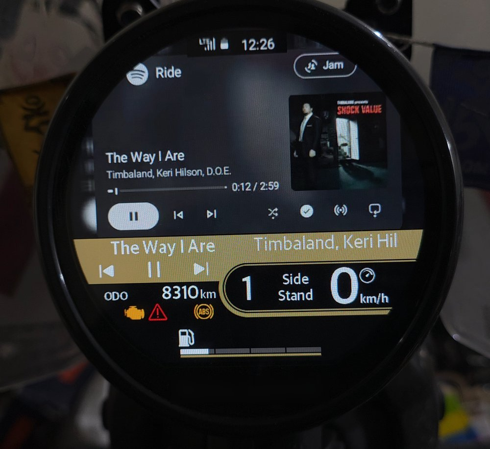
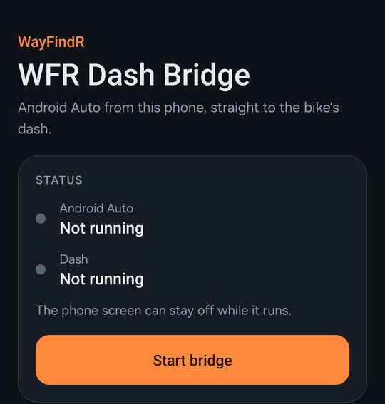
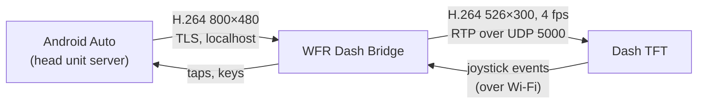

<div align="center">



# WFR Dash Bridge

**Android Auto on your motorcycle's round TFT dash, straight from your phone. No extra hardware.**

[](https://github.com/1857rebels/WayFindR-Dash-Bridge/releases)
[](#requirements)
[](app/src/main/java/com/wayfindr/hus)
[](app/build.gradle.kts)
[](LICENSE)

[Features](#features) •
[How it works](#how-it-works) •
[Getting started](#getting-started) •
[Download](https://github.com/1857rebels/WayFindR-Dash-Bridge/releases) •
[Riding](#riding-with-it) •
[Settings](#settings) •
[Roadmap](#roadmap) •
[Pi version](https://github.com/1857rebels/WayFindR-PI-Bridge)

<br>

<table>
  <tr>
    <td align="center"><br><b>Maps</b>: default nav view</td>
    <td align="center"><br><b>Music</b>: Alternate view</td>
  </tr>
</table>

</div>

---

WFR Dash Bridge connects to Android Auto's own **head unit server** on the same phone, crops and
re-encodes the picture for the Mt.Fuji 450's round dash, and streams it over the dash's Wi-Fi.
Google Maps and Spotify show up on the bike, the bike's joystick drives them, and the phone can
stay in your pocket with its screen off.

> **Prefer a separate box?** [WayFindR Pi Bridge](https://github.com/1857rebels/WayFindR-PI-Bridge)
> does the same with a Raspberry Pi Zero 2 W and a wireless Android Auto dongle, so the phone only
> runs Android Auto.

<p align="center">
  
</p>

## Features

- 🗺️ **Google Maps on the dash.** Android Auto's map, scaled to fit the round screen, with a
  blurred fill instead of black edges.
- 🕹️ **Joystick control.** Zoom in and out, re-centre, and switch between Maps and Music with the
  bike's own joystick.
- 🎵 **Music.** Spotify's full-screen player on the dash, with next, previous and play/pause.
- 🔋 **Phone screen off.** Runs as a foreground service; nothing is mirrored from the display.
- 🕐 **Status strip.** The phone's clock, signal and battery, movable and resizable.
- 📐 **Two views.** *Default nav* keeps the dash's turn circle and joystick zoom; *Alternate* gives
  the whole screen to the picture.
- 📶 **Automatic Wi-Fi.** Finds the dash's hotspot once, then rejoins it on its own.
- 🪶 **Lightweight.** Plain Kotlin and Android APIs, no third-party libraries.

## How it works



1. **Android Auto** thinks it's talking to a car. The app is that car: it offers the channels
   Android Auto needs and receives its video.
2. **The video pipeline** decodes the stream, composites the map, blur fill and status strip with
   OpenGL, and hardware-encodes a 526×300 picture for the dash.
3. **The dash session** authenticates with the dash, sends the 1 Hz heartbeat and route card, and
   streams the video over RTP.
4. **Joystick presses** come back from the dash and turn into taps and key presses in Android Auto.

## Getting started

### Requirements

- An Android phone with **Android 10 or newer** and Android Auto. Built and tested on a Samsung
  Galaxy S25 Ultra.
- A **Mt.Fuji 450** with the round TFT dash (firmware 11.63 tested).
- The dash's Wi-Fi password.

### Install

**Download the latest APK from [Releases](https://github.com/1857rebels/WayFindR-Dash-Bridge/releases)** and open it on the phone
(allow installing from your browser or file manager when Android asks).

Or build it yourself (see [Building from source](#building-from-source)) and install it over USB:

```bash
adb install -r app/build/outputs/apk/release/WayFindR-Dash-Bridge-release.apk
```

### Set up the phone

1. **Turn on Android Auto's developer mode.** Open Android Auto's settings, tap **Version** 10
   times and accept.
2. **Start the head unit server.** In Android Auto settings, open the ⋮ menu and choose
   **Start head unit server**. Repeat this after every phone restart.
3. **Check the driver seat.** Android Auto › Advanced › **Driver seat location** must match the
   app's seat setting (left by default).
4. **Start the bridge.** Open **WFR Dash Bridge**, allow location / nearby devices and
   notifications, check the settings, and tap **Start bridge**.
   - The first time, Android shows a picker for the dash's Wi-Fi (`RE_*`). Choose it.
   - After that the exact name and access point are saved, and it joins without asking.
5. **Ride.** The screen can be off. Stop the bridge from its notification or the app.

## Riding with it

### Joystick

| Dash mode | Press | Code | What happens |
|---|---|---|---|
| Map | Right | `0x13` | Zoom in |
| Map | Left | `0x14` | Zoom out |
| Map | Down | `0x15` | Re-centre the map |
| Map | Centre | `0x18` | The dash opens its own music controls |
| Music | Centre | `0x05` | Play / pause |
| Music | Right | `0x09` | Next track |
| Music | Left | `0x0A` | Previous track |
| Music | Down | `0x07` | **Music:** Alternate view + Spotify's player |
| Music | Up | `0x06` | **Maps:** Default nav view + Google Maps |

### Switching between Maps and Music

1. **Press the joystick centre.** The dash opens its music controls.
2. **Press DOWN for Music.** The dash switches to Alternate view and Android Auto opens Spotify's
   full-screen player.
3. **Press UP for Maps.** The dash switches back to default nav mode and Android Auto opens Google
   Maps.

> [!NOTE]
> - **Zoom and re-centre only work in default nav mode.** Alternate view has no turn circle on the
>   dash, and without it the dash doesn't send map presses. Press UP to get back to Maps first.
> - **The choice sticks.** The app saves the view and the app, and Android Auto reopens it after a
>   reconnect.
> - **From the phone,** **On the dash** (Maps / Music) and **View** (Default nav / Alternate) are
>   separate switches. The joystick changes both at once.
> - **UP and DOWN don't answer calls.** The app doesn't handle calls.

### Music details

- **Music** presses Android Auto's media button, which opens the last-used media app. With Spotify
  playing, it opens its full-screen player.
- If Spotify ever shows a browse screen instead, the app looks for Spotify's green now-playing
  button at (622, 332, 44×44) and taps it. It taps only when that spot is green, since in the
  player the same spot is the repeat button. Measured for the left seat only.

## Settings

All settings are on the app screen and saved when you leave it. They apply the next time the
bridge starts.

<details>
<summary><b>Full settings table</b> (with the Pi Bridge equivalents)</summary>

| Setting | Default | Pi equivalent |
|---|---|---|
| Wi-Fi name starts with / password | `RE_` / your dash's password | `DASH_PREFIX` / `DASH_PSK` |
| Dash Wi-Fi name | filled in once seen | the SSID in `/run/wayfindr/dash-ssid` |
| Route card | `turn` | `DASH_IDLE_CARD` |
| Seat | left | `AA_SEAT` |
| Map layout `scale,x,y` | empty = 0.876,87,41 (left) / 0.846,100,49 (right) | `FILL_LAYOUT` |
| On the dash: Maps / Music | Maps | `AA_LAUNCH` (switchable live) |
| View: Default nav / Alternate | Default | — (Alternate: map at 0.900,39,35, route card `nosymbol`, so no turn circle and no joystick zoom; switchable live) |
| Clock / signal / battery strip | on | `DASH_STATUS=top` |
| Clock strip `x,y,size` (each view) | empty = 186,4 at size 1.35 | — (top-left of the strip in the 526×300 frame; size 0.5–2.5 scales the 108×26 strip) |
| Alternate view map layout `scale,x,y` | 0.900,39,35 | — |
| Video bitrate | 200000 | `VIDEO_BITRATE` |
| Head unit server port | 5277 | — |

</details>

## Screen capture

**Capture Android Auto screen** saves Android Auto's whole 800×480 picture, before the dash crop,
for measuring button positions in other apps. With no dash connected it turns video on for 15 s to
take it.

```bash
adb pull /sdcard/Android/data/com.wayfindr.hus/files/captures
```

## Building from source

Requires the Android SDK (compile SDK 36) and JDK 17+.

```bash
git clone https://github.com/1857rebels/WayFindR-Dash-Bridge.git
cd WayFindR-Dash-Bridge
./gradlew assembleRelease
```

The APK lands in `app/build/outputs/apk/release/WayFindR-Dash-Bridge-release.apk`. Release
builds are signed with your local debug key, so they install over a debug build without losing
settings.

<details>
<summary><b>Project structure</b></summary>

| File | What it does |
|---|---|
| `BridgeService.kt` | Foreground service; runs the Android Auto loop, the dash loop, the joystick mapping and the stats. |
| `MainActivity.kt` | The app screen: status, start/stop, On the dash / View toggles, capture, setup steps, settings, log. |
| `Ui.kt` | Colours and view builders for that screen (cards, segmented toggles, fields, buttons). |
| `Config.kt` | Settings and the measured Android Auto coordinates (crop, side bar, zoom buttons, Re-centre strip). |
| `aa/AaTransport.kt` | Android Auto framing and TLS (`SSLEngine`, aasdk's head unit certificate). |
| `aa/AaSession.kt` | The head unit: channels, service discovery, video, sensors, mic, system audio, media status, touch and keys. |
| `aa/Pb.kt` | Minimal protobuf writer/reader (field numbers from aasdk_proto). |
| `video/VideoPipeline.kt` | Decoder → GL composite (blur fill, map, status strip, waiting card, Re-centre probe) → encoder. |
| `dash/` | The dash side: protocol, session, RTP video and Wi-Fi. Ported from the Pi Bridge. |
| `tools/build_icon.py` | Builds the adaptive launcher icon layers. |

</details>

<details>
<summary><b>App icon</b></summary>

The WayFindR icon with the arrow recoloured orange and an orange **BRIDGE** band.
`tools/build_icon.py` makes the adaptive icon layers from WayFindR's `ic_launcher_foreground`
(as a PNG):

```bash
python tools/build_icon.py <folder with ic_launcher_foreground.png> app/src/main/res
```

It writes `ic_launcher_foreground` and `ic_launcher_monochrome` (for Android's themed icons) in
every `mipmap-*` density; the background is the navy `#050D19` in `values/colors.xml`.

</details>

## Roadmap

- [x] Android Auto head unit on the phone
- [x] Video to the dash with the phone screen off
- [x] Joystick zoom, re-centre and media controls
- [x] Maps / Music switching from the joystick
- [x] Movable, resizable status strip
- [ ] Turn, distance and ETA on the dash's own widgets

<details>
<summary><b>Plan: turn, distance and ETA on the dash's own widgets</b></summary>

Show Android Auto's navigation details in the dash's turn circle and ETA box, as the
[WayFindR](https://github.com/1857rebels/WayFindR) app does. The map itself would still come from
Android Auto.

**What Android Auto can send.** It has a navigation status channel for car instrument clusters (as
in aasdk). This app doesn't offer that channel in service discovery yet, so nothing arrives today.
The data only comes while Google Maps (or likely Waze) is navigating a route.

| Data | Message | Confidence |
|---|---|---|
| Navigation on / off | navigation status | Certain (aasdk) |
| Next turn: road, turn type, side, roundabout exit number, turn angle, small turn image | next-turn event | Certain (aasdk) |
| Distance and time to the next turn, plus a display value and unit | next-turn distance event | Certain (aasdk) |
| Distance left to the destination, ETA / time left | newer navigation state / current position messages | Likely in recent Android Auto versions; not yet seen |

**Mapping to the dash.** These use the same dash fields as WayFindR:

| Android Auto | Dash TLV |
|---|---|
| Turn type + side + angle | `05 02` turn glyph |
| Distance to the turn | `05 04` / `05 06` (metres, or km×10) |
| Distance left | `05 09` / `05 46` |
| ETA | `05 08`, "HHMM" |

**Steps.**
1. Offer the navigation status channel and log every message. Start a Google Maps route with the
   bridge running, and read which fields the phone actually sends.
2. Send the turn glyph and distance to the dash, then ETA and distance left if step 1 shows them.

**Risks to check on the bike.**
- The joystick only works while the turn circle shows a symbol. Real glyphs should keep one there
  while navigating, but this needs confirming.
- The dash is sensitive to which route card it gets, so switching from the idle card to a live
  route card needs a test.

**Fallback.** If Android Auto doesn't send ETA or distance left, Google Maps' navigation
notification on the phone also shows them. The app could read it with notification access.

</details>

## Related projects

- [**WayFindR**](https://github.com/1857rebels/WayFindR): the full companion app, with its own navigation
  drawn for the dash, plus maintenance and fuel logs.
- [**WayFindR Pi Bridge**](https://github.com/1857rebels/WayFindR-PI-Bridge): this bridge on a
  Raspberry Pi Zero 2 W with a wireless Android Auto dongle.

## Acknowledgements

- [openDsh aasdk](https://github.com/openDsh/aasdk): the Android Auto protocol reference, and the
  source of the head unit certificate and protobuf field numbers.
- [better-dash](https://github.com/norbertFeron/better-dash): the starting point for the dash
  protocol.

## Disclaimer

This is an unofficial hobby project. It isn't affiliated with or endorsed by the motorcycle's maker
or by Google. Android Auto's head unit server is a developer feature and may change or disappear
in any update. Keep your eyes on the road: set things up before you ride.

## License

[MIT](LICENSE)
